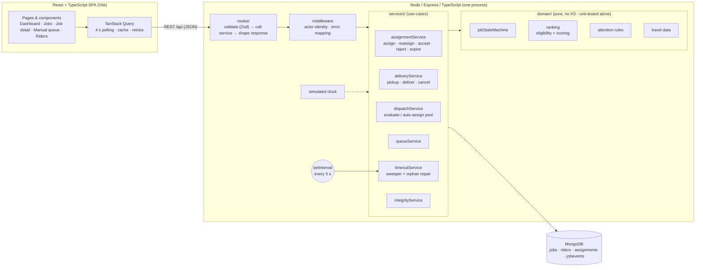
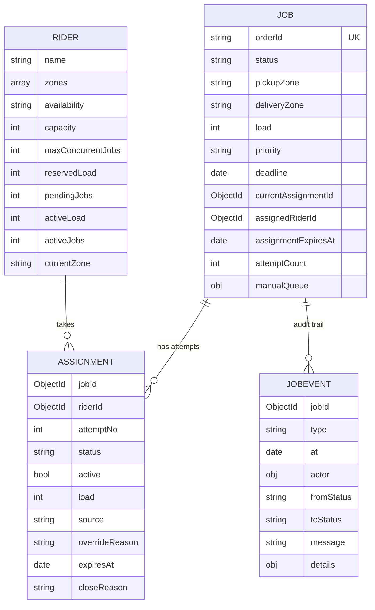
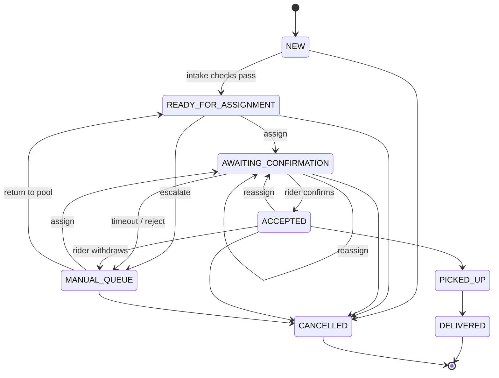
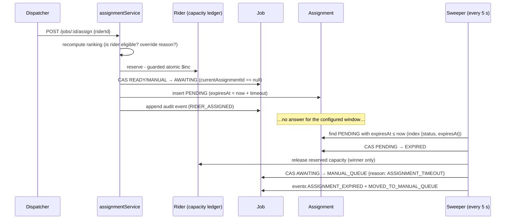

# RELAY - system design

> Goal: a dispatch desk a real operations team could use - correct under retries, double-clicks, two dispatchers and a
> timer firing mid-action - without distributed infrastructure the problem doesn’t need.

## 1. Architecture

**Layering rule:** routes know HTTP, services know the workflow, `domain/` knows the business rules and nothing else.
That is why “recommendation, assignment and timeout rules can be understood and tested independently”:
`ranking.ts`, `jobStateMachine.ts` and `attention.ts` are plain functions with 35 unit tests and no database; the
integration tests run the services against a real MongoDB.

## 2. Data model

**Job vs assignment attempt.** A *job* is *what* must be delivered and *where it is in its lifecycle*. An *assignment* is one
attempt to put one rider on it. A job accumulates assignments (timed out, rejected, reassigned, …) and **they are never deleted** —
that is the evidence. The job carries denormalised pointers (`currentAssignmentId`, `assignedRiderId`, `assignmentExpiresAt`) to the single
open attempt so lists and the dashboard need no join.

**History is its own collection.** `JobEvent` is append-only (type, time, actor, from/to status, rider, assignment, details). Status is never used to
reconstruct the past. It is ordered by `_id` (insertion order), so the story stays correct even when the simulated clock is moved.

**Embedded vs separate - the trade-off.** Embedding attempts or events in the job gives atomic “status + history” writes but unbounded array growth,
awkward cross-job queries (“all timeouts today”, “rider X’s open work”) and a hot document. Separate collections cost us multi-document consistency —
which we handle explicitly (§5) - and buy cheap indexed queries and an immutable log.

**Capacity ledger on the rider** (`reservedLoad/pendingJobs`, `activeLoad/activeJobs`): capacity is *reserved* when a rider is assigned, *committed*
when they accept, and *released* on reject / timeout / reassignment / cancel / delivery. Available = `capacity − active − reserved`.
Keeping it denormalised on the rider makes “can they take another job?” one document read and - crucially - lets a reservation be **one atomic guarded update**.

### Indexes and constraints (each protects a rule or serves a frequent query)

| Collection | Index | Purpose |
|---|---|---|
| jobs | `{orderId}` **unique** | duplicate-job prevention (race-safe) |
| jobs | `{status, priorityRank:-1, createdAt}` | operational queues: “everything in X, most urgent first” |
| jobs | `{pickupZone,status}`, `{deliveryZone,status}` | zone filters |
| jobs | `{assignedRiderId,status}` (sparse) | “what is rider X carrying” |
| assignments | `{jobId}` **unique, partial `active:true`** | **at most one open assignment per job - enforced by the database** |
| assignments | `{status, expiresAt}` | the timeout sweeper’s query |
| assignments | `{jobId, attemptNo}`, `{riderId, status}` | job history, rider workload |
| jobevents | `{jobId, _id}` | a job’s history in order |
| jobevents | `{type, at:-1}` | cross-job reporting (“recent timeouts”) |
| riders | `{availability, zones}` | candidate pre-filtering (future) |

`active` is a boolean mirror of `status ∈ {PENDING, ACCEPTED}` so the partial index uses plain equality (supported by every MongoDB version).

## 3. Job lifecycle

The 8 required states are kept as-is. Choices (all in `domain/jobStateMachine.ts`, the single source of truth):

* **No-eligible-rider is a flag, not a state.** The job stays `READY_FOR_ASSIGNMENT` (it “remains unassigned”) and is flagged + surfaced; escalation to `MANUAL_QUEUE` is an explicit human action. This keeps `MANUAL_QUEUE` meaning “a dispatcher must act on a failed attempt or an exception”.
* **Reject = timeout path.** A rejected attempt is closed, capacity released and the job goes to the Manual Queue, with the rider excluded from this job’s recommendations. (A timed-out rider is penalised, not banned - silence may mean busy.)
* **`ACCEPTED → MANUAL_QUEUE`** covers a rider who confirms then drops out before pickup.
* **`PICKED_UP` cannot be cancelled** (goods in transit). A `FAILED/RETURNED` branch is future work.
* `NEW → READY_FOR_ASSIGNMENT` happens in the same request after intake validation; both steps are audited.

## 4. Recommendation engine

Pure function `rankRiders(job, riders, ctx)` (`domain/ranking.ts`).

1. **Hard eligibility** - a rider failing any rule is never recommended; *all* failures are reported so the dispatcher sees the full picture:
   available · serves **pickup** zone · serves **delivery** zone · `capacity − active − reserved ≥ load` · a free job slot · has not rejected this job.
2. **Score 0–100** = Σ factor × weight × 100, factors normalised to 0..1:

   | Factor | Meaning | NORMAL/LOW | HIGH | URGENT |
   |---|---|---|---|---|
   | travel | closeness of the rider to the pickup (45 min horizon → 0) | .35 | .45 | .55 |
   | workload | spare job slots `1 − jobs/max` | .30 | .20 | .10 |
   | fit | right-sizing: prefers the smallest sufficient rider so vans stay free for big loads | .10 | .05 | .05 |
   | deadline | slack between projected ETA and the deadline (30 min = full marks; none = full marks) | .25 | .30 | .30 |

   Projected ETA = rider→pickup + pickup→delivery + 5 min handling. A rider who would miss the deadline scores 0 on that factor and gets a warning
   (not excluded - the dispatcher may still need them). A rider who previously let this job time out loses 15 points.
3. **Order:** score ↓, then fewer open jobs, then shorter ETA, then name - deterministic.

**Explaining the choice.** Every candidate carries its per-factor points, plain-language `reasons`/`warnings`, and an `explanation` that names the runner-up
and the factor that decided it (“Recommended over Rahul Verma: 9.4 pts higher, mainly closer to pickup”). The same text is stored in the `RIDER_ASSIGNED` event.
**Overrides:** choosing anyone but #1 requires a written reason, stored on the assignment and as a `MANUAL_OVERRIDE` event naming both riders and scores.
The ranking is recomputed at assignment time, so a stale screen cannot assign a rider who has since become ineligible.

## 5. Consistency & concurrency

MongoDB gives atomicity per document, not per workflow. We did **not** use multi-document transactions - they need a replica set,
which would make “clone and run” harder and standalone `mongod` unusable. Instead the design makes every write a **single-document
compare-and-set (CAS)** and orders the steps so a crash leaves something detectable.

Two rules carry the whole design:

> **1. The Job document decides the story.** Every status change is a CAS on `(status, currentAssignmentId)` in one function (`transitionJob`) that also asserts the move against the state machine. Exactly one racing caller wins.
> **2. The Assignment document decides who releases capacity.** Assignment status changes are CAS too; *only the winner* applies the matching rider-ledger delta. So a reservation is released **exactly once**, even if accept, reject, timeout and cancel all fire together. Deltas are commutative `$inc`s, so the order in which two different winners apply them does not matter.

| Risk | What could go wrong | How it is addressed |
|---|---|---|
| **Duplicate job** (retry, double-click, two tabs) | two jobs for one order | unique index on `orderId`; on `E11000` the loser reads the winner. Same payload → returns the original (`duplicate:true`); different payload → `409`. Tested with 25 parallel submits. |
| **Two dispatchers assign one job** | job double-assigned, capacity reserved twice | `assign` claims the job with a CAS requiring `currentAssignmentId == null` and a matching status; the loser releases its reservation and gets `409 JOB_STATE_CHANGED`. Backstop: partial unique index on `{jobId, active}`. A *different* rider for an already-assigned job is a conflict, never a silent overwrite (use `reassign`, which takes `expectedAssignmentId`). |
| **Over-committing a rider** | two jobs both “fit” a rider with room for one | the check and the increment are **one** `findOneAndUpdate` with an `$expr` guard (`active+reserved+load ≤ capacity` and `jobs < max`) - it cannot oversubscribe. Tested with 8 parallel assignments to a 3-slot rider. |
| **Timeout vs. accept** | a rider accepts at the instant the sweeper expires them | `accept` CAS requires `status=PENDING ∧ expiresAt > now`; `expire` CAS requires `status=PENDING ∧ expiresAt ≤ now`. Mutually exclusive, so exactly one wins. A late accept is refused (`409 ASSIGNMENT_EXPIRED`) and *itself* triggers the expiry (lazy timeout) so the job never waits for the next sweep. |
| **Timeout vs. reassign/cancel** | sweeper moves a job that was just reassigned | the job-level CAS requires `currentAssignmentId == this attempt`; if the pointer moved, the sweeper only closes its own attempt and leaves the job alone. |
| **Retried requests** | double release of capacity | every write is idempotent: it returns the existing result (`idempotentReplay`) rather than acting twice; ledger changes are tied to winning a CAS. Tested: retrying accept/pickup/deliver/cancel leaves the ledger unchanged. |
| **Crash between two writes** | no transactions → partial state | steps are ordered so the failure modes are *under*-commit and *detectable*: reserve capacity → claim job → insert assignment → audit. `repairOrphans` finds `AWAITING_CONFIRMATION` jobs whose assignment is missing/closed and routes them to the manual queue (`ORPHANED_ASSIGNMENT`), so nothing is silently stuck. |
| **Ledger drift** (any bug / crash) | stored capacity ≠ reality | `GET /system/integrity` recomputes the ledger from assignments and reports drift; `POST …/repair` fixes it. The integration tests assert `ok` after nearly every scenario - including the concurrent ones. |
| **Audit event lost** after a state change | history ≠ state | events are written immediately after the CAS; the residual crash window is called out below with the outbox/transaction fix. |

## 6. Assignment workflow and timeout handling

* **Configurable threshold:** default 120 min (`ASSIGNMENT_TIMEOUT_MINUTES`), changeable at runtime (`PUT /system/config`, fractions allowed). Each assignment *snapshots* its own `expiresAt`, so changing the setting never retroactively changes live assignments.
* **Testable without waiting:** every time read goes through one `clock`; `POST /system/clock/advance` moves it, `POST /system/sweep` runs the pass immediately. Event timestamps follow the simulated clock; event *order* uses insertion order.
* **Three independent safety nets:** the sweeper, lazy expiry inside `accept`, and orphan repair. All use the same CAS, so they can run concurrently or on several instances.
* **After a timeout** the job is in the Manual Queue with the reason recorded, the `EXPIRED` attempt retained, the reservation released, and the job immediately assignable again (`attemptNo` increments).

## 7. Frontend

React + TypeScript + Tailwind CSS (light theme, shared class recipes in `components/ui/cls.ts`), TanStack Query for server state (4 s polling, retry, cache invalidation after every action), React Router (filters live in the URL so dashboard cards deep-link).
`motion` (`motion/react`) drives: animated KPI counters, staggered lists, shared-layout nav/segment indicators, spring modals/toasts, the draining countdown ring,
the lifecycle stepper, the score bars and the timeline. Every screen has loading skeletons, empty states, retryable error states, field-level validation (client + server) and toasts for failed actions;
`prefers-reduced-motion` is respected. Countdowns follow the *server’s* clock (offset-corrected) so simulated time looks right.

## 8. Scaling path (what changes, and when)

| Pressure | Next step |
|---|---|
| Recommendation scans all riders | pre-filter with the `{availability, zones}` index; cache zone→riders; beyond ~10⁴ riders, geo-index + candidate generation |
| `attention` computed over open jobs on every dashboard read | maintain an `attentionCode` field / materialised view updated on state change; or compute in the sweeper |
| Polling every 4 s | Server-Sent Events / change streams for pushes |
| Several API instances | the CAS design already tolerates it; move the sweeper to a lock/lease (or a queue with delayed jobs) and the clock/settings to the database |
| Crash window between state and audit event | MongoDB transactions (replica set) or a transactional **outbox**; the guard-and-CAS code stays the same |
| Events table growth | TTL/archival by `at`, partition by month |
| Real riders | rider app/WebSocket for confirmations; push notifications; the `accept/reject` endpoints are already the contract |
| Auth | JWT + roles; `X-Actor-*` headers become claims |
